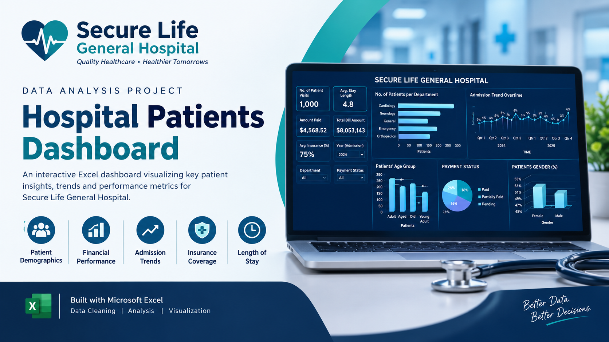
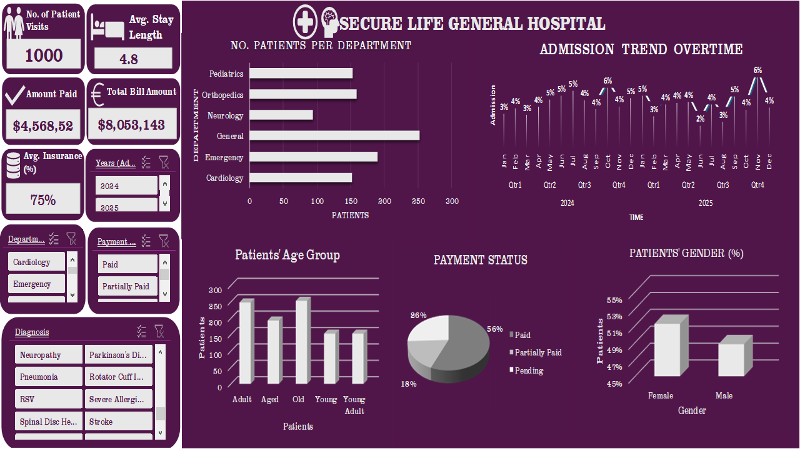

# A-DATA-ANALYSIS-PROJECT-ON-SECURE-LIFE-HOSPITAL-S-PATIENTS-AND-PERFORMANCE-EVALUATION.

## INTRODUCTION

This project is one of the projects I completed during an online Data Analytics internship/training at FadaQa Tech Scholarship Program. It served as a necessary requirement for successful completion of the second cohort of the program and collection of certificates.
FadaQa is a non-profit organization whose mission is to empower, educate and promote an accessible and affordable tech community where youths with bright future are empowered and equipped with skills, knowledge and competencies that will help to foster their financial independence, employability, income generation and overall socio-economic empowerment.

## ABOUT THE DATA SET

The data set contains structured and detailed information about the hospital’s patients’ management records, financial inflows and insurance coverages. This includes: the Patient Ids, Patient Names, Age, Gender, Admission Date, Discharge Date, Department, Diagnosis, Total Bill Amount, Insurance Coverage (%), and Payment Status.

However, in the process of executing the project, I went ahead to uses the available information to analyze the following: 

- The age group using the age information

- Length of stay using the admission and discharge dates

- The estimated bill covered by insurance, actual bill covered by patients and,

- The total payment received by the hospital.

## PROBLEM STATEMENT
The management of Secure Life General Hospital has observed a change in patient admissions, outstanding medical bills, and variations in insurance coverage across its departments. The hospital wants to use patient admission, billing and insurance data to understand its operational performance, monitor payments and improve management decision-making. However, the hospital currently lacks a consolidated report that provides a clear picture of its operational and financial performance. 

## VISUALIZATION

Microsoft Excel was used to design and build this interactive dashboard for analyzing trends and patterns in the hospital’s patient admissions, payment inflows, insurance coverages and overall financial performance across several departments and years. 

## INSIGHTS
After analysis of the hospital’s dataset and visualization, the following insights were drawn:

**Total Patients Record:** The hospital admitted 1000 patients across 2 years (2024 and 2025). 508 patients were admitted in 2024, while 492 patients were admitted in 2025. This shows that the hospital admitted a 16 more patient in 2025 than the previous year.

**The General Department recorded the highest number of patients:** The General Department 252 (25%) accounted for approximately one-quarter of all patient records which makes it the busiest department by patient volume, while Neurology recorded the fewest patients 94 (9.4%). 

**Orthopedics department generated the highest total bill amount:** Orthopedics recorded the highest total bill amount which is approximately $2.55 million, even though General had the highest number of patient records. Cardiology ranked second in total billing, while Pediatrics recorded the lowest total. 

**Payment Status:** A substantial proportion of bills remain pending or partially paid. Although 56.4% of patient records are marked Paid, the remaining 43.6% are classified as Pending or Partially Paid. Together, these two categories account for 436 patient records.

**Insurance Coverage:** The average insurance coverage is approximately 75%. For context, a patient with a bill of $10,000 and insurance coverage of 75% would have an estimated insurance-covered amount of $7,500, leaving $2,500 before considering other adjustments or payments. The dataset suggests that insurance covers a substantial proportion of the bills on average. However, insurance coverage varies between patients, and the average coverage percentage does not necessarily equal the proportion of total hospital bills paid by insurers.

**Length of Stay:** The average patient stay is 4.81 days (approximately five days). Length of stay can affect bed availability, staffing requirements, and the cost of delivering care.

**Gender Distribution:** 
Female patients account for a slightly larger share of records. There are 512 (51.2%) females and 492 (4.92%) males.

## RECOMMENDATION FOR FURTHER ANALYSIS
Based on the insights gotten from the analysis of the hospital’s dataset, the following are the recommendations for further analysis on the hospital’s patient records management and operational performance.

-	The Hospital management could examine staffing, appointment scheduling, and resource allocation across departments to ensure that patient demand is adequately supported. However, the number of records alone does not establish whether a department is understaffed or overstaffed.

-	The total bill amount by department reveals an important difference between patient volume and financial activity which shows that the volume of patients’ visits does not determine the financial inflow of each department. Therefore, the management could investigate why billing differs across departments. Possible factors include treatment complexity, procedure costs, length of stay, and the mix of services provided.

-	Further analysis should investigate the financial implications of the Pending and Partially Paid records. This could help the hospital to strengthen its billing and improve revenue follow-up and collection.

## CONCLUSION
This project shows how Microsoft Excel can be used to analyze a hospital patient data and transform raw records into meaningful insights. The analysis highlighted several patterns and trends in patients’ admissions, departmental activities, billing, insurance coverage, and payment status. The interactive dashboard provides a clear overview of the hospital operations and also demonstrates how data analysis and visualization can be used to support informed decision-making. Further analysis could provide deeper insights into financial performance, resource allocation, and patient service delivery.
